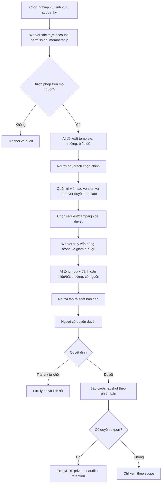

# HTS – Thiết kế Trung tâm Báo cáo thông minh bằng AI

**Trạng thái:** Thiết kế nghiệp vụ và dữ liệu; không gọi API AI, không xuất dữ liệu thật.
**Kiến trúc chuẩn:** [HTS_CLOUDFLARE_D1_CANONICAL_ARCHITECTURE.md](./HTS_CLOUDFLARE_D1_CANONICAL_ARCHITECTURE.md).
**Đối chiếu nghiệp vụ:** `README_HTS_v5.0.md` mục 8–14, 20 và các quyết định trong mục 38–39; `docs/HTS_D1_AUTH_RBAC_DESIGN.md`; `docs/HTS_AI_TEACHING_AND_CURRICULUM_DESIGN.md`. Báo cáo Supabase/D1 chỉ là bằng chứng lịch sử.

## 1. Mục tiêu và nguyên tắc

Trung tâm Báo cáo số phục vụ bảy lĩnh vực HTS; mỗi chức năng nghiệp vụ cần báo cáo/thống kê phù hợp với mục đích, phạm vi và quyền. AI hỗ trợ hiểu cấu trúc dữ liệu, đề xuất mẫu/trường/biểu đồ, tổng hợp, phát hiện thiếu/bất thường và giúp người phụ trách tạo báo cáo.

- Báo cáo chính thức tiếp tục theo nguyên tắc README: **yêu cầu được duyệt trước, báo cáo sau**; báo cáo gắn campaign/request/template version, trừ ngoại lệ được cấu hình và audit.
- Thống kê/ad-hoc preview có thể là đầu ra phân tích, không tự biến thành báo cáo chính thức hoặc thay thế quy trình yêu cầu/phê duyệt.
- Giáo viên/người phụ trách chọn, điều chỉnh trong phạm vi được cấp hoặc từ chối đề xuất AI. Quản trị viên lĩnh vực tạo/sửa template trong scope; template chuẩn phải qua người phê duyệt được chỉ định.
- AI không tự phê duyệt template, báo cáo, kết quả học tập; không kết luận vi phạm; không đưa ra quyết định thay người có thẩm quyền.
- AI chỉ nhận dữ liệu trong scope được kiểm tra ở server, cần thiết cho mục đích đã khai báo và được phép gửi đến provider. Không gửi hồ sơ xác minh Lực lượng vũ trang, dữ liệu sinh trắc, bí mật, danh sách học sinh định danh hoặc dữ liệu cá nhân hàng loạt tới dịch vụ công cộng/chưa duyệt.
- Mọi báo cáo/biểu đồ phải thể hiện phạm vi dữ liệu, khoảng thời gian, định nghĩa chỉ số, nguồn và thời điểm chốt. Mọi xuất file ghi người tạo, quyền/phạm vi, bộ lọc, người duyệt nếu áp dụng, thời điểm và audit.

## 2. Vai trò và quyền hạn

| Vai trò | Quyền |
|---|---|
| Giáo viên | Xem/tạo báo cáo của lớp, môn, năm học được phân công; chọn mẫu được phép; xem chi tiết cá nhân chỉ khi permission đó được cấp |
| Người phụ trách/nhóm trưởng | Tạo báo cáo và tổng hợp trong nhóm được giao; không mặc định xem, tải hoặc xuất dữ liệu ngoài nhóm |
| Quản trị lĩnh vực | Tạo/sửa/phiên bản hóa template, cấu hình campaign và phạm vi lĩnh vực được giao; phê duyệt template/báo cáo chỉ khi có permission |
| Người duyệt được ủy quyền | Duyệt/trả lại/từ chối đúng loại báo cáo và scope; quyết định có lý do, phiên bản được duyệt |
| Quản trị cấp cao | Quản lý nền tảng và quyền theo thẩm quyền; truy cập dữ liệu chi tiết hoặc xuất vẫn phải theo quyền, mục đích và audit |
| Người học/thành viên | Gửi yêu cầu/báo cáo và xem dữ liệu của chính mình hoặc phạm vi được phép |
| AI | Đề xuất và tổng hợp dữ liệu đã được Worker cấp; không cấp quyền, vượt scope, duyệt hoặc công bố |

Hành động cần phân quyền riêng: `report.create`, `report.submit`, `report.review`, `report.approve`, `report.template.manage`, `report.export`, `report.detail.view`, `report.ai.use` và quyền truy cập dữ liệu nguồn. Không suy quyền từ menu hoặc role label.

## 3. Quy trình nghiệp vụ

### 3.1. AI phân tích nhu cầu và đề xuất template

1. Người dùng chọn lĩnh vực, nghiệp vụ, mục đích, scope, kỳ báo cáo và nhóm người nhận.
2. Worker xác thực account, membership, role grant, assignment, permission, scope và mục đích; xác định danh mục trường/nguồn được phép trước khi đọc dữ liệu.
3. AI nhận schema mô tả/metadata hoặc dữ liệu tối thiểu đã giảm định danh; đề xuất mẫu, trường bắt buộc/tùy chọn, bộ lọc, chỉ số, loại biểu đồ và cách trình bày.
4. Hệ thống lưu đề xuất ở trạng thái draft/proposed cùng nguồn/schema version, AI job, thời điểm và cảnh báo. Không tự tạo template chuẩn hoặc cấp quyền dùng dữ liệu.
5. Giáo viên/người phụ trách lựa chọn/sửa đề xuất; quản trị viên lĩnh vực tạo phiên bản template và người được ủy quyền phê duyệt trước khi cung cấp chính thức.

### 3.2. Tạo và duyệt báo cáo

1. Chọn template đã được duyệt, phiên bản, campaign/request được chấp thuận, scope và kỳ.
2. Worker truy vấn dữ liệu đúng scope; kiểm tra quyền từng trường, hạn chế dữ liệu cá nhân và giới hạn tập dữ liệu.
3. AI tổng hợp/đề xuất trình bày và cảnh báo dữ liệu thiếu/bất thường kèm căn cứ; không sửa nguồn gốc âm thầm. Mọi phát hiện cần phân biệt dữ liệu trống, lỗi nhập, ngoại lệ nghiệp vụ và bất thường thống kê.
4. Người tạo kiểm tra nội dung, phạm vi, bộ lọc, định nghĩa chỉ số và chi tiết được hiển thị; hoàn tất báo cáo theo quy trình yêu cầu trước.
5. Người có quyền review/approve quyết định chấp thuận, trả lại hoặc từ chối. Lưu phiên bản, người, thời điểm, lý do và dữ liệu nguồn/snapshot cần thiết.
6. Cấp trên xem aggregate từ cấp dưới theo quyền và truy nguyên được nguồn; không sao chép bản ghi gốc vô cớ. Muốn xem từng cá nhân cần permission cụ thể, mục đích và scope.

### 3.3. Xuất và lưu trữ

1. Người dùng chọn định dạng Excel/PDF, phạm vi, thời gian, cột và mục đích.
2. Worker kiểm tra quyền `report.export` riêng, quyền cho từng trường/đối tượng, phê duyệt nếu chính sách yêu cầu, và giảm dữ liệu theo vai trò.
3. Tạo file ở vùng private; URL tải có thời hạn ngắn và chỉ cấp sau kiểm tra quyền.
4. Ghi metadata export: người tạo, thời điểm, scope, kỳ, template/version, bộ lọc, định dạng, trạng thái, người duyệt (nếu có), tham chiếu nguồn và kết quả. Ghi audit cả lần thất bại quan trọng.
5. Hết hạn file theo retention; file export không thành đường truy cập vòng qua RBAC.

## 4. Luồng xử lý

## 5. Mẫu báo cáo và thống kê đề xuất

Đây là **mẫu khởi điểm để quản trị viên lĩnh vực tùy biến và phê duyệt**, không thay hai mẫu biểu Lực lượng vũ trang gốc trong README. Danh sách trường là cấu trúc logic; dữ liệu chi tiết có thể bị ẩn theo quyền.

| Mẫu | Mục tiêu/nhóm chỉ số | Phạm vi thường dùng | Trình bày |
|---|---|---|---|
| Tiến độ học tập | Người tham gia, nội dung hoàn thành, tiến độ, kết quả đã duyệt, xu hướng theo kỳ | Cá nhân/lớp/nhóm/trường/đơn vị | KPI, bảng theo thời gian, cột tiến độ; không xếp hạng mặc định |
| Chuyên cần/điểm danh | Buổi dự kiến, mốc thành công/thiếu, vắng, thời gian, tỷ lệ tham gia và xác minh thủ công | Cá nhân/lớp/nhóm/đơn vị | Bảng tổng hợp, chuỗi thời gian, danh sách cần rà soát; không gán kết luận kỷ luật |
| Kết quả bài tập/thi | Số bài, trạng thái chấm, điểm AI đề xuất/giáo viên xác nhận/đã duyệt, câu cần rà soát | Môn/lớp/năm học và assignment hợp lệ | Phân bố thống kê và bảng; tách rõ điểm đề xuất với kết quả chính thức |
| Hoạt động báo cáo | Yêu cầu, submission, trạng thái duyệt, đúng hạn, trả lại/bổ sung | Nhóm/đơn vị/lĩnh vực/campaign | Funnel/trạng thái và bảng kỳ |
| Hoạt động lớp/nhóm | Số thành viên hợp lệ, tham gia hoạt động, tiến độ | Lớp/nhóm/đơn vị | KPI và bảng theo thời gian; chỉ hiển thị định danh khi được phép |
| Báo cáo tổng hợp lĩnh vực | Chỉ số đã định nghĩa của các đơn vị trực thuộc, hoàn thành theo kỳ | Scope lĩnh vực được cấp | Bảng tổng hợp, xu hướng, biểu đồ so sánh có chú giải; không drill-down vượt quyền |
| Chất lượng dữ liệu | Thiếu trường, bản ghi trùng/nghi vấn, lệch kỳ, trạng thái không nhất quán | Scope dữ liệu được quản trị | Danh sách cảnh báo có nguồn và trạng thái xử lý; AI không sửa tự động |

Có thể cung cấp báo cáo chi tiết cá nhân/nhóm chỉ khi quyền, mục đích và phạm vi cho phép. Báo cáo ngành giáo dục loại trừ Công dân học tập và Công nhân học tập theo quyết định hiện hành; báo cáo chung HTS vẫn bao gồm đủ bảy lĩnh vực được cấp quyền.

## 6. Trường metadata tối thiểu trên mỗi báo cáo

- `report_id`, loại báo cáo, template ID/version, lĩnh vực, campaign/request ID (nếu là báo cáo chính thức).
- Scope dữ liệu (lớp/nhóm/trường/đơn vị/lĩnh vực), bộ lọc và thời gian bắt đầu/kết thúc, múi giờ và thời điểm chốt.
- Các định nghĩa chỉ số, đơn vị đo, nguồn dữ liệu và phiên bản/schema nguồn.
- Người tạo, người review/approve, quyết định, lý do, timestamps, trạng thái và phiên bản nội dung.
- AI job/model/provider (nếu sử dụng), loại hỗ trợ, nguồn được cung cấp, cảnh báo/độ không chắc chắn; không ghi payload nhạy cảm trong log.
- Xuất: loại file, người tạo, phạm vi/cột, thời gian, trạng thái tạo/tải, phê duyệt nếu cần, retention/expiry.

## 7. D1 đề xuất và tránh trùng lặp

README và báo cáo rà soát D1 đã đề xuất: `report_domains`, `report_org_units`, `report_memberships`, `report_groups`, `report_group_members`, `report_group_role_history`, `report_templates`, `report_template_fields`, `report_template_versions`, `report_campaigns`, `report_requests`, `report_request_reviews`, `report_submissions`, `report_submission_versions`, `report_approvals`, `report_attachments`, `report_ai_extractions`, `report_activity_logs`.

- Tái sử dụng `report_templates`/`report_template_versions` cho mẫu chuẩn và lịch sử; không thêm `ai_report_templates` song song.
- Tái sử dụng `report_ai_extractions` cho OCR/AI có nguồn và trạng thái rà soát; dùng `ai_jobs` của nền tảng AI nếu schema hiện hữu phù hợp, không tạo job subsystem trùng.
- Tái sử dụng `report_activity_logs`/`audit_events` cho sự kiện nghiệp vụ/bảo mật theo ranh giới rõ.
- Tái sử dụng `data_exports`/`attachments` nếu đã lưu đủ owner, scope, phiên bản, trạng thái, expiry và liên kết; `report_attachments` có thể là quan hệ nghiệp vụ thay vì lưu tệp trùng.
- Bảng bổ sung không được khẳng định trước khi kiểm tra D1 thật. Trước migration lập inventory, xác định chuẩn tên và quan hệ, đánh giá dữ liệu/khóa và được phê duyệt.

## 8. Xuất Excel/PDF an toàn

- File chỉ tạo sau kiểm tra quyền riêng cho export và giới hạn cột/hàng theo scope; chi tiết cá nhân mặc định ẩn khỏi aggregate.
- Excel có worksheet tổng hợp và chi tiết chỉ khi được phép; ghi rõ kỳ, phạm vi, template version, định nghĩa chỉ số, thời điểm tạo và đơn vị/múi giờ. PDF có metadata tương đương.
- Không nhúng macro, credential, token, URL công khai hay dữ liệu không thuộc báo cáo.
- Xử lý ô văn bản do người dùng cung cấp theo chính sách an toàn để ngăn nội dung bị hiểu như công thức khi mở trong bảng tính; kiểm soát tên worksheet, cột và kích thước file.
- Không đưa data URI/object key riêng tư có thể truy cập công khai vào workbook. Tệp để private storage, URL tải có hạn.
- Lưu nhật ký xuất/tải và hạn lưu file. Nếu nội dung hoặc người nhận gửi ngoài HTS thay đổi, áp dụng quy trình yêu cầu–trích yếu–phê duyệt–gửi lại theo README.

## 9. AI, bảo mật và chất lượng dữ liệu

- Trước khi gọi AI, Worker tạo dataset tối thiểu đúng scope; chỉ gửi trường cần thiết. Dùng aggregate/giảm định danh khi có thể.
- Không cho AI nhận query tùy ý hoặc tự chọn bảng. Chỉ dùng truy vấn/metrics đã được định nghĩa và kiểm tra quyền.
- Yêu cầu AI nêu trường thiếu, số lượng ảnh hưởng, nguồn, phương pháp và mức không chắc chắn. Không biến tương quan thành nguyên nhân hoặc phát hiện thống kê thành kết luận cá nhân.
- Người phụ trách xác nhận định nghĩa, dữ liệu, ngoại lệ và mẫu trình bày. Ghi version input/output phù hợp, tránh lưu dữ liệu nhạy cảm dư thừa.
- Dữ liệu trẻ em, sức khỏe, gia đình, sinh trắc, hồ sơ Lực lượng vũ trang và dân cư không gửi provider ngoài nếu chưa có phê duyệt cụ thể, căn cứ và biện pháp bảo vệ.
- Bảo vệ prompt injection từ tài liệu/tệp: nguồn dữ liệu không được thay đổi scope, system policy hoặc yêu cầu công cụ; output được xem như nội dung chưa tin cậy.
- Có quota và kiểm soát chi phí; tài liệu này không chọn provider hay gọi API.

## 10. Các quyết định cần chủ dự án phê duyệt

1. Danh mục mẫu chuẩn theo lĩnh vực, định nghĩa chỉ số và người/role phê duyệt template.
2. Quy tắc tiếp tục bắt buộc yêu cầu được duyệt trước mọi báo cáo chính thức; loại thống kê ad-hoc nào được phép và giới hạn.
3. Ma trận quyền xem aggregate, drill-down, dữ liệu cá nhân, export và gửi báo cáo ra ngoài HTS.
4. Các nguồn dữ liệu/nghiệp vụ được cấp cho AI; provider, khu vực lưu trữ, quota/ngân sách, retention và chính sách huấn luyện.
5. Ngưỡng phát hiện thiếu/bất thường và quy trình người xử lý; không tự đưa ra kết luận hoặc quyết định kỷ luật.
6. Định dạng Excel/PDF, mẫu hiển thị, metadata bắt buộc, giới hạn dung lượng/hàng và thời hạn tải file.
7. Thời hạn lưu báo cáo, phiên bản, log và export; quy trình xóa/ẩn danh.
8. Rà soát schema D1 hiện có để xác nhận khả năng tái sử dụng các bảng đề xuất.

Tài liệu không tạo bảng D1, không sửa mã nguồn, không gọi AI provider và không xuất dữ liệu thật.
