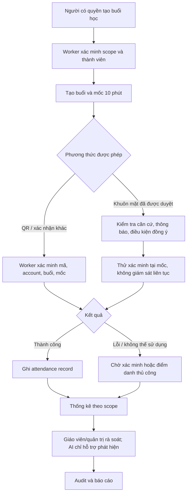

# HTS – Thiết kế điểm danh và bảo vệ dữ liệu sinh trắc học

**Trạng thái:** Thiết kế nghiệp vụ; không triển khai nhận diện khuôn mặt hoặc xử lý dữ liệu thật.
**Kiến trúc chuẩn:** [HTS_CLOUDFLARE_D1_CANONICAL_ARCHITECTURE.md](./HTS_CLOUDFLARE_D1_CANONICAL_ARCHITECTURE.md).
**Đối chiếu nghiệp vụ:** `README_HTS_v5.0.md` mục điểm danh/giám sát; `docs/HTS_DATABASE_AND_SECURITY_PLAN.md`; `docs/HTS_D1_AUTH_RBAC_DESIGN.md`. Báo cáo Supabase/D1 là nguồn kiểm kê lịch sử, không phải kiến trúc runtime.

## 1. Phạm vi và nguyên tắc

- Điểm danh áp dụng cho thành viên tham gia hoạt động học tập thuộc phạm vi tổ chức, gồm người học, giáo viên và thành viên khác theo chính sách buổi học.
- Mốc **10 phút/lần** là xác nhận hiện diện trong buổi học đã đăng ký, không phải theo dõi liên tục thiết bị, vị trí hoặc mọi hành vi người dùng.
- Công dân học tập và Công nhân học tập được miễn **điểm danh khuôn mặt bắt buộc theo chu kỳ**. Quy định này không tự động miễn các hình thức điểm danh khác nếu chương trình học có yêu cầu hợp lệ và được thông báo.
- Một lượt nhận diện thất bại, QR lỗi hoặc thiết bị không hỗ trợ không tự động đồng nghĩa vắng mặt/vi phạm. Cần trạng thái chờ xác minh và phương thức thay thế.
- Không mặc định bật camera hay bắt buộc sinh trắc. Trước mọi xử lý khuôn mặt phải xác định căn cứ pháp lý, mục đích, thông báo, điều kiện đồng ý phù hợp và đánh giá rủi ro; đặc biệt thận trọng với trẻ em và Lực lượng vũ trang.
- Giáo viên/quản trị được xem dữ liệu theo scope. AI chỉ tổng hợp hoặc nêu bất thường để con người rà soát; không kết luận vi phạm, không tự phạt/kỷ luật.

## 2. Quy trình nghiệp vụ

### 2.1. Tạo buổi học và lịch điểm danh

1. Người có quyền tạo buổi học, gắn khóa/lớp/nhóm/đơn vị, người tham gia dự kiến, giờ bắt đầu/kết thúc, lĩnh vực và chính sách điểm danh đã duyệt.
2. Server xác nhận người tạo có quyền trên toàn bộ các scope và người tham gia có membership/đăng ký hợp lệ.
3. Hệ thống tạo các mốc mục tiêu cách nhau 10 phút trong khoảng thời gian buổi học. Quy tắc làm tròn mốc đầu/cuối, grace period, lịch học bị đổi và giờ gián đoạn cần được chủ dự án chốt trước khi lập trình.
4. Thành viên nhận thông báo phương thức được phép và lựa chọn thay thế áp dụng cho buổi đó.

### 2.2. Xác nhận hiện diện

1. Người tham gia xác nhận tại từng mốc bằng QR/mã buổi học hoặc phương thức được duyệt.
2. Nếu chính sách đã được phê duyệt cho phép nhận diện khuôn mặt và người tham gia đáp ứng điều kiện thông báo/đồng ý, hệ thống có thể gửi yêu cầu xác minh tại mốc; không chạy giám sát nền liên tục.
3. Worker kiểm tra session, membership, buổi học, mốc thời gian, quyền và trạng thái cho phép xử lý trước khi ghi nhận.
4. Kết quả được lưu là thành công, thất bại/chờ xác minh, vắng mốc theo quy tắc đã duyệt, hoặc xác nhận thủ công; luôn lưu nguồn phương thức và actor chịu trách nhiệm phù hợp.
5. Lỗi thiết bị, ảnh không rõ, trường hợp không thể dùng sinh trắc hoặc khiếu nại được chuyển xác minh thủ công, không tự chuyển thành vi phạm.

### 2.3. Kết thúc và rà soát

- Tổng hợp số buổi, mốc dự kiến/thành công/thiếu, thời gian tham gia, vắng mặt theo quy tắc đã chốt và tỷ lệ tham gia theo cá nhân/lớp/nhóm/đơn vị.
- Người có quyền rà soát/chỉnh sửa phải nêu lý do; giữ lịch sử giá trị cũ/mới, người thao tác và thời gian.
- AI có thể cảnh báo dữ liệu bất thường (ví dụ cùng một mã xác nhận dùng lặp, mốc thiếu bất thường, sai lệch đồng hồ), nhưng không đưa ra quyết định kỷ luật. Tín hiệu phải có nguồn và mức độ không chắc chắn.
- Báo cáo/exports tuân theo quyền báo cáo, mục đích, phạm vi, lịch sử xuất và chính sách lưu trữ.

## 3. Sơ đồ luồng

## 4. Phương án xác nhận thay thế nhận diện khuôn mặt

Ưu tiên phương án ít xâm lấn, có thể kết hợp theo chính sách:

1. QR/mã buổi học luân phiên hoặc mã cá nhân dùng trong cửa sổ thời gian ngắn, có chống dùng lại và giới hạn chia sẻ; không dùng QR tĩnh làm bằng chứng duy nhất nếu rủi ro không phù hợp.
2. Xác nhận trong tài khoản HTS sau khi xác thực, kèm mã do giáo viên hiển thị hoặc xác nhận tại lớp.
3. Giáo viên/điểm danh viên ghi nhận thủ công với lý do và audit.
4. Danh sách tham gia được đối chiếu sau buổi học cho hoạt động mất mạng/thiết bị hỏng; lưu người xác nhận và nguồn đối chiếu.

Không bắt buộc định vị GPS, theo dõi nền hoặc thu thêm dữ liệu thiết bị nếu không có mục đích, căn cứ và phê duyệt riêng. Không dùng phương thức thay thế để ép người học cung cấp dữ liệu nhạy cảm khác.

## 5. Vai trò và quyền hạn

| Vai trò | Quyền trong phạm vi |
|---|---|
| Người tham gia | Xem buổi/mốc của mình, xác nhận hiện diện, yêu cầu sửa sai/khiếu nại và chọn phương án thay thế được cung cấp |
| Giáo viên/điểm danh viên được giao | Tạo hoặc quản lý buổi theo assignment; xem danh sách cần thiết; xác minh thủ công; yêu cầu chỉnh lý có lý do |
| Quản trị lĩnh vực/đơn vị | Quản lý chính sách, báo cáo và nhân sự trong scope được grant; không xem sinh trắc nếu không có quyền riêng |
| Quản trị cấp cao | Quản trị nền tảng theo thẩm quyền; truy cập dữ liệu chi tiết vẫn phải có quyền/mục đích và được audit |
| Người kiểm toán/bảo mật | Xem nhật ký cần thiết; không mặc định xem nội dung ảnh/mẫu sinh trắc |
| AI | Nhận dữ liệu giảm định danh/tổng hợp cần thiết; đưa ra gợi ý; không xác minh danh tính hoặc ra quyết định kỷ luật |

## 6. Mô hình bảng D1 cần đối chiếu

Trong `docs/BAO_CAO_RA_SOAT_SUPABASE_D1.md` đã có ba bảng ứng viên: `attendance_sessions`, `attendance_records`, `attendance_verifications`. Không tạo bản sao mang tên khác trước khi rà soát schema.

- `attendance_sessions`: buổi học, scope, thời gian, chính sách/mốc và trạng thái.
- `attendance_records`: account, session, mốc, trạng thái kết quả, phương thức, thời gian xác nhận, actor/nguồn và tham chiếu đến quy trình xác minh nếu cần.
- `attendance_verifications`: kết quả xác minh và trạng thái xử lý lỗi/thủ công, người xử lý, lý do tối thiểu và dấu thời gian.
- Quan hệ tới account, membership, lớp/nhóm, course/lesson và teacher assignment phải dùng định danh hiện hành; quyền server kiểm tra trước khi trả dữ liệu.
- Lịch sử chỉnh sửa, export và quyết định có thể dùng `audit_events`, `report_activity_logs`/`data_exports` nếu đã đáp ứng; không tạo audit thứ hai cùng mục đích.
- Có thể cân nhắc `biometric_processing_authorizations` hoặc consent chung hiện hữu để lưu phiên bản thông báo/căn cứ/đồng ý/rút lại. Đây là ứng viên chưa được duyệt, không lưu dữ liệu khuôn mặt.
- Mẫu sinh trắc (nếu được phép) không đặt trong D1; không lưu ảnh chụp liên tục. Nếu thật sự cần mẫu, phải qua đánh giá/duyệt độc lập, kho chuyên dụng được phép, mã hóa và kiểm soát khóa, retention/xóa rõ ràng. D1 chỉ tham chiếu opaque tối thiểu nếu cần thiết.

## 7. Bảo vệ dữ liệu sinh trắc học và vận hành

- Trước triển khai: xác nhận căn cứ pháp lý và mục đích cụ thể; đánh giá tác động/quyền riêng tư, tính cần thiết và tương xứng; thiết kế thông báo, đồng ý phù hợp; có phương án tương đương không sinh trắc.
- Không mặc định đồng ý bằng việc tạo tài khoản. Có quy trình ghi nhận, rút lại/đổi phương thức và xử lý khi người tham gia không thể hoặc không muốn dùng.
- Thu tối thiểu; ưu tiên xử lý xác minh tại thời điểm cần thiết. Không dùng ảnh/mẫu khuôn mặt cho quảng cáo, huấn luyện AI, phân tích cảm xúc hay mục đích ngoài điểm danh đã thông báo.
- Nếu được duyệt lưu mẫu: mã hóa khi truyền/lưu, giới hạn người và dịch vụ có thể giải mã, tách khóa, audit truy cập, thời hạn ngắn nhất được phép, xóa an toàn và kiểm chứng việc xóa.
- Hạn chế truy cập cho người chưa thành niên theo quy định áp dụng, sự đồng ý/ủy quyền hợp lệ và lợi ích tốt nhất; không triển khai mặc định tại trường.
- Với Lực lượng vũ trang, xác minh căn cứ và môi trường lưu trữ được cấp có thẩm quyền chấp thuận; không gửi khuôn mặt, metadata định danh hoặc hồ sơ của lực lượng tới AI/dịch vụ công cộng.
- Quy trình sự cố gồm cô lập truy cập, bảo toàn log cần thiết, đánh giá phạm vi, thông báo theo quy định, điều tra/xóa/khắc phục và tiếp nhận yêu cầu chủ thể dữ liệu.
- Thời hạn lưu attendance record, verification metadata, ảnh tạm (nếu có) và mẫu sinh trắc phải được xác định riêng. Không giữ vô thời hạn vì tiện lợi.

## 8. Bảo mật và kiểm thử chấp nhận

- Worker xác minh account, session, buổi, membership, mốc, phương thức cho phép và chống gửi lặp; không nhận account/scope/status tin cậy từ client.
- Mỗi đọc, xác minh thủ công, thay đổi kết quả, xem chi tiết nhạy cảm và export ghi audit phù hợp; log không chứa ảnh, template hoặc token.
- Kiểm thử quyền chéo lớp/lĩnh vực/đơn vị; hết hạn/thu hồi assignment; QR hết hạn/dùng lại; thời gian lệch; buổi đổi lịch; mất mạng; camera không hỗ trợ; dữ liệu không đồng ý; trẻ em; Lực lượng vũ trang; export không đủ quyền.
- Kiểm thử AI bằng dữ liệu tổng hợp: phát hiện cảnh báo không biến thành kết luận tự động, nêu nguồn/độ không chắc chắn và vẫn cần quyết định của người có quyền.

## 9. Các nội dung cần phê duyệt

1. Phạm vi người/buổi phải điểm danh; hai lĩnh vực được miễn face-cycle không đồng nghĩa mặc định miễn attendance.
2. Cửa sổ mốc, mốc đầu/cuối, grace period, ngoại lệ và cách tính thời gian tham gia.
3. Phương thức thay thế được hỗ trợ và trách nhiệm người xác nhận thủ công.
4. Có/không thử nhận diện khuôn mặt; căn cứ, nhóm tuổi, điều kiện đồng ý, nhà cung cấp/hạ tầng và đánh giá tác động.
5. Chính sách retention/xóa, xử lý rút đồng ý, khiếu nại, sự cố và quyền xem dữ liệu.
6. Phân biệt attendance record với báo cáo chuyên cần, và quyền xem/xuất từng cấp.

Chỉ sau các phê duyệt và rà soát schema mới lập đặc tả triển khai. Tài liệu này không tạo bảng, migration hoặc tích hợp nhận diện.
