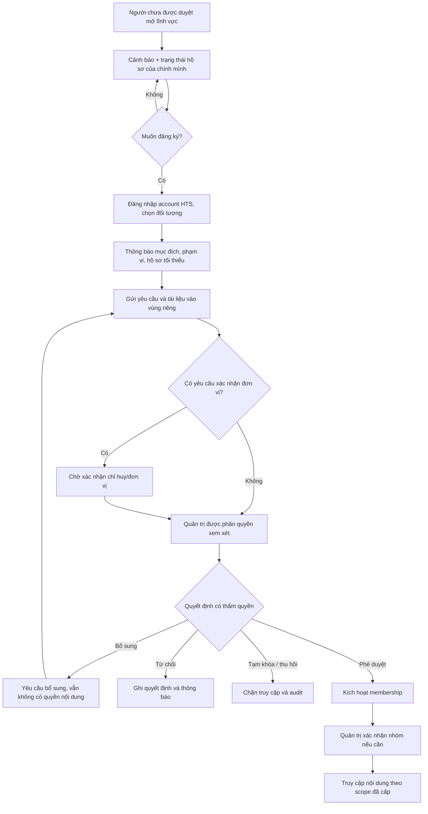

# HTS – Thiết kế truy cập lĩnh vực và xác minh Lực lượng vũ trang

**Trạng thái:** Thiết kế; không thu thập hồ sơ thật và không cấp quyền thực tế.
**Kiến trúc chuẩn:** [HTS_CLOUDFLARE_D1_CANONICAL_ARCHITECTURE.md](./HTS_CLOUDFLARE_D1_CANONICAL_ARCHITECTURE.md).
**Đối chiếu nghiệp vụ:** `README_HTS_v5.0.md` mục 2, 5, 29–31, 35–39; `docs/HTS_D1_AUTH_RBAC_DESIGN.md`; `docs/HTS_ADMIN_SUBSCRIPTION_AND_PI_PAYMENT_DESIGN.md`. Báo cáo Supabase/D1 là nguồn kiểm kê lịch sử.

## 1. Nguyên tắc truy cập

- Mỗi người dùng có một account/định danh duy nhất. Một account có thể tham gia đồng thời nhiều lĩnh vực và nhiều nhóm/lớp/khóa; mỗi membership có trạng thái, tiến độ, kết quả và scope riêng.
- Membership trong một lĩnh vực không cấp quyền trong lĩnh vực khác; quyền quản trị là role/permission grant riêng, có phạm vi và thời hạn.
- Toàn bộ hoạt động học tập đều miễn phí. Membership hoặc nội dung Lực lượng vũ trang có thể yêu cầu xác minh/phê duyệt trước khi truy cập; điều kiện này không phải học phí, và không yêu cầu mua gói quản trị để được học sau khi đủ điều kiện.
- Thanh toán gói quản trị Pi không tự cấp membership đặc biệt hoặc quyền quản trị. Việc cấp quyền quản trị cần Super Admin phê duyệt riêng; học tập và quyền quản trị hết hạn/thu hồi được xử lý độc lập.
- Bảy lĩnh vực chính thức giữ nguyên. Nội dung mở của Công dân học tập và Công nhân học tập vẫn có thể xem không cần đăng nhập; cá nhân hóa, lưu tiến độ và tham gia nhóm áp dụng xác thực phù hợp.
- Lực lượng vũ trang là khu vực hạn chế, không cho truy cập tự do. Trước khi thành viên được duyệt, mọi đường dẫn/API/tệp nội bộ phải bị từ chối ở server. Không tiết lộ danh sách thành viên, metadata nội dung hoặc object URL.
- HTS thông thường không lưu bí mật nhà nước, bí mật quân sự, thông tin cơ yếu, kế hoạch/tình hình tác chiến hoặc dữ liệu nghiệp vụ chưa được cấp thẩm quyền cho phép.

## 2. Màn hình cảnh báo trước đăng ký

Khi người dùng mở mục Lực lượng vũ trang nhưng chưa được cấp quyền membership, chỉ hiển thị cảnh báo và trạng thái hồ sơ của chính họ:

> ĐÂY LÀ KHU VỰC HỌC TẬP DÀNH RIÊNG CHO QUÂN NHÂN VÀ CÁN BỘ, CHIẾN SĨ CÔNG AN ĐỦ ĐIỀU KIỆN.
>
> Nếu bạn không thuộc đối tượng được phép tham gia, vui lòng không tiếp tục đăng ký hoặc truy cập.

Không hiển thị bài giảng, file, nhóm, danh sách thành viên, báo cáo nội bộ hoặc nội dung gợi ý tiết lộ nội dung hạn chế. Endpoint trực tiếp và URL tệp phải được bảo vệ tương tự trang giao diện.

## 3. Quy trình đăng ký và xác minh

1. Người dùng đăng nhập HTS bằng account hiện có; chọn đối tượng “quân nhân” hoặc “cán bộ, chiến sĩ công an”.
2. Hệ thống giải thích dữ liệu tối thiểu cần cung cấp, mục đích, người có thể xem, thời hạn dự kiến và quy trình khiếu nại/xóa theo chính sách đã duyệt.
3. Người đăng ký khai báo thông tin tối thiểu, cung cấp bằng chứng theo quy trình được duyệt và gửi yêu cầu. Hồ sơ chưa được xác minh không cấp quyền nội dung.
4. Nếu quy trình dựa trên danh sách đơn vị, xác nhận của chỉ huy/đơn vị là bước bắt buộc như README đã ghi. Không tự tra cứu hoặc suy luận cấp bậc/chức vụ/đơn vị từ dữ liệu không được phép.
5. Quản trị viên Lực lượng vũ trang được phân quyền kiểm tra trong scope; Super Admin xem xét theo thẩm quyền. Chỉ người có quyền phê duyệt còn hiệu lực mới được ra quyết định.
6. Theo quy trình README hiện hữu, một người có thẩm quyền được phép có thể phê duyệt; nếu Field Admin chưa có quyền duyệt thì chỉ được xem/đề xuất. Bất đồng được ghi nhận và chuyển quy trình khiếu nại/đình chỉ. Cơ chế hai cấp bắt buộc phải được chủ dự án phê duyệt rõ, không mặc định thay đổi quyết định cũ.
7. Sau phê duyệt, membership được kích hoạt; thêm vào nhóm cụ thể là hành động riêng cần xác nhận người quản trị. Việc tham gia lĩnh vực không tự cấp vai trò quản trị.
8. Từ chối, yêu cầu bổ sung, tạm khóa hoặc thu hồi đều lưu người ra quyết định, lý do tối thiểu, thời gian và lịch sử. Thu hồi chặn truy cập mới và vô hiệu hóa session/URL phù hợp; không xóa audit.

### Trạng thái nghiệp vụ hiển thị

- Chưa đăng ký.
- Đã gửi yêu cầu.
- Đang chờ xác minh.
- Yêu cầu bổ sung giấy tờ.
- Đã phê duyệt.
- Từ chối.
- Tạm khóa.
- Thu hồi quyền truy cập.

README đã có các trạng thái kỹ thuật như `pending_unit_confirmation`, `pending_field_admin`, `needs_revision`, `approved`, `rejected`, `revoked`. Cần chuẩn hóa một state machine API/database; nhãn giao diện ở trên không được làm nguồn cấp quyền. Trạng thái “chưa đăng ký” có thể là trạng thái giao diện, không nhất thiết là bản ghi hồ sơ.

## 4. Sơ đồ luồng

## 5. Vai trò và quyền

| Vai trò | Được phép | Không mặc định được phép |
|---|---|---|
| Người chưa đăng ký/đang chờ | Xem cảnh báo, trạng thái/yêu cầu của chính mình, bổ sung hồ sơ qua kênh riêng | Xem bài giảng, tải tài liệu, danh sách thành viên, nhóm hay dữ liệu nội bộ |
| Thành viên được duyệt | Truy cập nội dung và nhóm theo membership đã kích hoạt | Tự mở rộng đơn vị/nhóm; xem hồ sơ xác minh người khác |
| Field Admin được giao | Quản lý thành viên/nội dung/nhóm và xét duyệt trong đúng permission/scope còn hiệu lực | Tự cấp quyền cho mình; duyệt ngoài scope; tự cấp role quản trị; xem hồ sơ không cần thiết |
| Super Admin | Quản lý quyền nền tảng và xem xét yêu cầu đặc biệt theo thẩm quyền | Bỏ qua audit/căn cứ mục đích; mặc định dùng dữ liệu để huấn luyện AI |
| Người xác nhận đơn vị | Xác nhận tư cách trong phạm vi quy trình được phê duyệt | Cấp role HTS hoặc xem/tải toàn bộ dữ liệu ngoài phạm vi xác nhận |
| AI | Không xử lý hồ sơ xác minh; có thể hỗ trợ nội dung không nhạy cảm đã được phép | Xác minh tư cách, đọc giấy tờ, cấp/từ chối quyền hoặc huấn luyện trên hồ sơ |

## 6. Bảng D1 ứng viên

Các tên dưới đây đã xuất hiện trong báo cáo D1/README, chưa xác nhận tồn tại:

- `accounts`, `user_profiles`, `learning_field_memberships`, `role_grants`, `permission_grants`, `organization_scopes`, `scope_relations`, `audit_events`, `security_events`: account và authorization chuẩn dùng chung.
- `military_member_approval_requests`: yêu cầu, trạng thái và quyết định membership; cần xác định có lưu thông tin định danh tối thiểu nào.
- `military_unit_approval_documents`: metadata tham chiếu tài liệu xác minh và trạng thái. Tệp thực phải ở private storage, không lưu blob/đường dẫn công khai trong D1.
- `military_unit_memberships`, `military_learning_groups`, `military_group_members`: tư cách đơn vị/nhóm sau xác minh và kích hoạt.
- `military_access_audit`: nếu chưa được đáp ứng bởi `audit_events`, dùng cho nhật ký truy cập đặc thù; cần tránh ghi trùng hoặc ghi dữ liệu giấy tờ trong log.
- `report_activity_logs`, `data_exports`, `attachments`: đối chiếu trước khi bổ sung lịch sử xem/tải/xuất.

Không đề xuất một bộ bảng `verification_*` song song trong tài liệu này. Trước migration cần xác định chức năng từng bảng hiện hữu, hợp nhất audit, quy định khóa và quan hệ tới account/membership. Không lưu nội dung bí mật quân sự hoặc nhà nước trong bất kỳ bảng nào.

## 7. Bảo vệ hồ sơ xác minh và nội dung

- Chỉ thu thập giấy tờ/thông tin tối thiểu để xác minh điều kiện tham gia; không yêu cầu dữ liệu không cần thiết hoặc tài liệu mật.
- Tệp đặt trong vùng private riêng, mã hóa khi truyền/lưu, không có URL công khai hoặc URL ký dài hạn; Worker kiểm tra quyền ở từng lần cấp URL/tải.
- Tách quyền xem, tải, duyệt, từ chối, xóa và export. Ghi audit từng lần xem/tải/duyệt/từ chối/thu hồi với actor, mục đích hoặc lý do phù hợp và kết quả.
- Không đưa giấy tờ lên GitHub, log, prompt AI hoặc dịch vụ OCR/AI công cộng. Không dùng hồ sơ làm dữ liệu huấn luyện.
- Xác định retention theo loại hồ sơ và căn cứ; có quy trình hết hạn, xóa an toàn, xử lý yêu cầu xóa, legal hold nếu có và bằng chứng hoàn tất.
- Nội dung học tập phải được kiểm duyệt riêng và phân loại trước khi lưu. Không mặc định mọi tài liệu Quân đội/Công an được phép lên HTS.
- Phê duyệt HTS không thay thế thẩm quyền của cơ quan/đơn vị hoặc giấy phép xử lý dữ liệu.

## 8. Audit và kiểm soát bảo mật

Audit tối thiểu: account actor; hành động; hồ sơ/membership tham chiếu; scope; thời gian; kết quả; quyết định/lý do cần thiết; phiên bản chính sách. Không ghi bản sao giấy tờ, ảnh sinh trắc, token hoặc nội dung bí mật vào metadata.

Kiểm thử bắt buộc: truy cập qua UI/API/tệp trước và sau phê duyệt; đoán ID; session cũ sau thu hồi; Field Admin không có permission; Field Admin ở lĩnh vực khác; Super Admin theo scope; bổ sung hồ sơ; bất đồng người duyệt; file URL hết hạn; quyền export; log không rò nội dung; yêu cầu retention/xóa và sự cố.

## 9. Các quyết định cần chủ dự án phê duyệt

1. Cơ quan/đơn vị được phép xác minh và căn cứ xác nhận; cách áp dụng điều kiện “chỉ huy xác nhận” theo từng loại đăng ký.
2. Cơ chế phê duyệt: một approver có thẩm quyền như README hay bắt buộc đồng thuận Field Admin và Super Admin; xử lý bất đồng, khiếu nại và quyền khẩn cấp.
3. Danh mục dữ liệu/giấy tờ tối thiểu được phép thu và thông tin cần che trên bản sao.
4. Kho tệp, khu vực lưu trữ, mã hóa/quản lý khóa, thời hạn lưu, xóa và xử lý yêu cầu của chủ thể dữ liệu.
5. Quyền xem/tải/export của Field Admin, Super Admin, người xác nhận và người kiểm toán.
6. Quy trình duyệt học liệu Lực lượng vũ trang và phân loại nội dung không được phép lưu trên HTS.
7. Chính sách cho người chưa thành niên và bảo vệ dữ liệu nhạy cảm.

Thiết kế này không thu thập dữ liệu cá nhân thật, không cấp quyền và không tạo bảng/migration.
