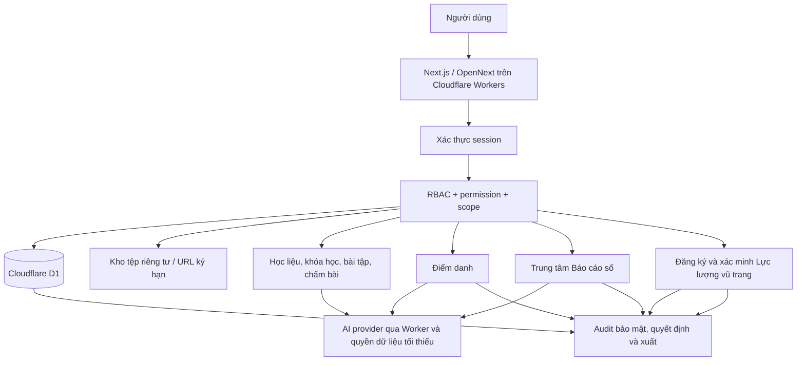

# HTS – Kiến trúc tổng thể hợp nhất

**Vai trò tài liệu:** Bản tổng hợp nghiệp vụ và danh mục bảng ứng viên. Kiến trúc kỹ thuật chuẩn duy nhất hiện hành là [HTS_CLOUDFLARE_D1_CANONICAL_ARCHITECTURE.md](./HTS_CLOUDFLARE_D1_CANONICAL_ARCHITECTURE.md); tài liệu này không phải một nguồn kiến trúc/backend chuẩn song song.
**Trạng thái:** Tài liệu thiết kế; chưa phải đặc tả migration hay xác nhận triển khai.
**Quyết định kiến trúc (26/11/2026):** Cloudflare Workers + D1 là backend/database chính thức duy nhất. Không duy trì Supabase hoặc hai database song song. Mọi nhắc đến Supabase trong tài liệu kiểm toán là bối cảnh lịch sử; tài nguyên bên ngoài chưa xác minh không bị xóa hoặc sửa.
**Cơ sở đối chiếu:** `README_HTS_v5.0.md`, `docs/BAO_CAO_RA_SOAT_SUPABASE_D1.md`, `docs/HTS_D1_AUTH_RBAC_DESIGN.md`, `docs/HTS_AI_TEACHING_AND_CURRICULUM_DESIGN.md`, `docs/HTS_DATABASE_AND_SECURITY_PLAN.md`, `docs/HTS_EDUCATION_MANAGEMENT_IMPLEMENTATION.md` và yêu cầu bổ sung của chủ dự án.
**Mục tiêu dữ liệu:** Cloudflare D1 theo hồ sơ kiến trúc hiện hành. Không suy diễn rằng D1 production đã có schema hoặc dữ liệu.

## 1. Mục đích và phạm vi

Tài liệu này kết nối tài khoản/RBAC, lĩnh vực học tập, quản lý giáo dục, Trung tâm Bài giảng AI, bài tập/chấm bài, điểm danh, Trung tâm Báo cáo số, kho tệp, nhật ký, quy trình đăng ký Lực lượng vũ trang và gói quyền quản trị. Các tài liệu chuyên đề đi kèm:

- `docs/HTS_ATTENDANCE_AND_BIOMETRIC_DESIGN.md`
- `docs/HTS_FIELD_ACCESS_AND_VERIFICATION_DESIGN.md`
- `docs/HTS_AI_REPORTING_DESIGN.md`
- `docs/HTS_ADMIN_SUBSCRIPTION_AND_PI_PAYMENT_DESIGN.md`

Đây là thiết kế, không phải xác nhận các tính năng đã hoàn thành. Tài liệu không thay thế yêu cầu báo cáo chính thức của README: báo cáo nghiệp vụ chính thức phải gắn với yêu cầu/đợt được duyệt, trừ ngoại lệ được cấu hình và ghi nhật ký. Dân Cư Số tiếp tục là phân hệ riêng, không phải lĩnh vực học tập thứ tám.

## 2. Nguyên tắc kiến trúc đã thống nhất

1. **Một người, một tài khoản/định danh:** Một `account_id` dùng cho nhiều lĩnh vực, trường, lớp, nhóm và khóa học. Membership, tiến độ, kết quả, trạng thái và quyền được lưu riêng theo từng phạm vi; không nhân bản tài khoản để tham gia lĩnh vực khác.
2. **Không suy quyền từ membership:** Đăng ký học, tư cách giáo viên, thành viên nhóm, Field Admin và Super Admin là các quan hệ/quyền khác nhau. Mỗi grant cần scope, trạng thái, hiệu lực, người cấp và lịch sử.
3. **RBAC + scope + permission:** Mặc định từ chối. Kiểm tra ở server/Worker cho mỗi thao tác; quyền xem không hàm ý sửa, duyệt, tải hay xuất. Giao diện không phải ranh giới bảo mật.
4. **D1 chỉ qua Worker:** Worker xác thực session, kiểm tra trạng thái account, grant, scope, mục đích và quyền hành động trước khi đọc/ghi D1 hoặc cấp tệp.
5. **AI hỗ trợ, con người chịu trách nhiệm:** AI có thể phân tích, trích xuất, tổng hợp, phát hiện dấu hiệu cần rà soát và đề xuất. AI không tự cấp quyền, xác minh tư cách, phê duyệt, công bố kết quả, kết luận vi phạm hoặc quyết định kỷ luật.
6. **Tách dữ liệu theo mục đích và mức nhạy cảm:** Dữ liệu trẻ em, sinh trắc, hồ sơ xác minh Lực lượng vũ trang, dân cư và hồ sơ học tập chỉ được xử lý trong phạm vi cần thiết, được phép và có audit.
7. **Không làm mất quyết định cũ:** Công dân học tập và Công nhân học tập vẫn thuộc HTS và Trung tâm Báo cáo số; chỉ bị loại khỏi báo cáo quản lý giáo dục nhà trường/ngành theo quy tắc hiện hành. Nội dung học tập mở không bắt buộc có tài khoản, nhưng chức năng cá nhân hóa/ghi nhận cần tài khoản theo chính sách.
8. **Học tập miễn phí, quản trị tách biệt:** Toàn bộ hoạt động học tập trong bảy lĩnh vực miễn phí, không phụ thuộc việc mua gói quản trị. Membership đặc biệt có thể cần xác minh/phê duyệt; đó là điều kiện truy cập, không phải phí học tập.
9. **Thanh toán không tự cấp quyền:** Gói quyền quản trị thanh toán bằng Pi Network; thanh toán thành công chỉ ghi nhận giao dịch và chuyển yêu cầu sang chờ Super Admin xét duyệt. Grant chỉ được tạo/kích hoạt bởi quyết định của Super Admin, có account, role, scope và thời hạn cụ thể.
10. **Ngoại lệ Super Admin duy nhất:** Tài khoản Super Admin tối cao đã được xác minh của chủ dự án được miễn phí quản trị vĩnh viễn; mọi tài khoản quản trị khác cần gói thời hạn Pi. Ngoại lệ gắn với đúng account đã bootstrap, không thể tự nhận qua dữ liệu client.
11. **Không phát sinh bảng bằng tài liệu:** Tên bảng dưới đây là danh mục thiết kế để đối chiếu. Trước khi lập migration, phải kiểm tra schema D1 hiện hữu, migration, dữ liệu, khóa, bảng tương đương, lưu trữ tệp và phương án sao lưu/khôi phục.

## 3. Sơ đồ các phân hệ và luồng dữ liệu

AI chỉ nhận dữ liệu đã được Worker giới hạn theo người yêu cầu, mục đích, scope, phiên bản nguồn và chính sách dữ liệu. Không để AI truy vấn trực tiếp D1, kho tệp hoặc toàn bộ lĩnh vực.

## 4. Định danh, lĩnh vực và phân quyền

- `accounts` là định danh đăng nhập duy nhất; `user_profiles` chứa hồ sơ cơ bản.
- Membership lĩnh vực (tên đã đề xuất: `learning_field_memberships`, `user_field_memberships`) thể hiện tư cách học tập và trạng thái riêng của từng lĩnh vực. Tên/ý nghĩa thực tế cần hợp nhất sau khi xem schema.
- `school_memberships`, `class_memberships`, `group_memberships`, `unit_memberships` và `teacher_assignments` giữ quan hệ tổ chức, năm học, môn học và hiệu lực riêng.
- `roles`, `permissions`, `role_grants`, `permission_grants`, `organization_scopes`/`scope_relations` thể hiện quyền được cấp. Không tạo grant bằng dữ liệu do trình duyệt tự gửi.
- Một tài khoản có thể có nhiều membership và grant đồng thời. Việc vào một lĩnh vực không tạo quyền quản trị lĩnh vực khác.
- Quyền Super Admin, Field Admin và các vai trò nghiệp vụ giữ theo hồ sơ đã thống nhất; quyền quản trị có trạng thái, thời hạn và lịch sử. Mô hình một Super Admin duy nhất trong README cần được triển khai cùng MFA, khôi phục và kiểm soát khẩn cấp đã được phê duyệt.
- Học tập và quyền quản trị là hai entitlement độc lập. Gói Pi chỉ gắn với yêu cầu quyền quản trị; giá và thời hạn được chụp tại thời điểm tạo đơn, còn việc cấp quyền phải qua Super Admin.

### 4.1. Phân biệt entitlement

| Loại | Phạm vi | Điều kiện |
|---|---|---|
| Học tập miễn phí | Bài giảng/chương trình, học liệu được phép, bài tập/kiểm tra/nộp bài, AI giảng dạy theo chính sách, lớp/nhóm, kết quả và tiến độ | Account/membership phù hợp với lĩnh vực; không yêu cầu mua gói quản trị |
| Quyền quản trị có phí | Thao tác quản trị được giao trong vai trò/lĩnh vực/scope | Tài khoản quản trị phải có gói Pi đã xác minh **và** Super Admin phê duyệt/cấp grant có thời hạn; chỉ tài khoản Super Admin tối cao đã xác minh của chủ dự án được miễn |
| Truy cập đặc biệt cần duyệt | Membership/nội dung giới hạn, ví dụ Lực lượng vũ trang | Xác minh tư cách và phê duyệt membership theo quy trình; không thu phí học tập |

## 5. Liên kết nghiệp vụ

| Phân hệ | Định danh và quan hệ dùng chung | Ranh giới riêng |
|---|---|---|
| Bài giảng AI, học liệu, bài tập, chấm bài | `account_id`; membership, lớp, môn, năm học, assignment | AI không publish/chốt điểm; giáo viên và người duyệt có quyền tương ứng |
| Điểm danh | `account_id`; buổi học/khóa học/lớp/nhóm/đơn vị; lịch đăng ký | Bản ghi mốc hiện diện, phương thức xác minh, scope và chính sách lưu giữ |
| Báo cáo | `account_id`; lĩnh vực, tổ chức, nhóm, campaign, yêu cầu | Yêu cầu được duyệt trước báo cáo chính thức; template, phiên bản, approval và export có audit |
| Lực lượng vũ trang | `account_id`; yêu cầu membership, đơn vị và nhóm đã xác minh | Chặn nội dung nội bộ trước phê duyệt; hồ sơ và học liệu được kiểm soát riêng |
| Gói quyền quản trị và thanh toán Pi | Account, gói giá tại thời điểm tạo đơn, mã giao dịch Pi, yêu cầu quản trị và grant được duyệt | Tách trạng thái thanh toán khỏi quyết định cấp quyền; chỉ Super Admin cấp grant; hết hạn không ảnh hưởng dữ liệu/quyền học tập |
| Kho tệp | `account_id`; object reference và quan hệ nghiệp vụ | Private-by-default; Worker kiểm tra quyền trước khi upload/download |
| Audit | actor, entity, scope, action, outcome, timestamp | Không ghi bí mật, token, ảnh sinh trắc hay nội dung hồ sơ nhạy cảm không cần thiết |

`cong-dan` và `cong-nhan` bị loại khỏi báo cáo quản lý giáo dục nhà trường/ngành, không bị loại khỏi báo cáo HTS dùng chung. Báo cáo tổng hợp nhiều lĩnh vực chỉ trả về mỗi phần dữ liệu mà người yêu cầu có quyền xem.

## 6. Danh mục bảng D1 đề xuất và đối chiếu trùng lặp

Các tên trong tài liệu rà soát D1, README và thiết kế RBAC là **tên ứng viên**, không phải bảng đã kiểm chứng trong database. Danh mục này chủ ý tái sử dụng tên đã nêu; không tạo một bộ bảng song song cho cùng nghiệp vụ.

### 6.1. Dùng lại danh mục đã đề xuất

**Tài khoản, role, membership, scope:** `accounts`, `account_identity_links`, `user_profiles`, `auth_credentials`, `auth_sessions`, `roles`, `permissions`, `role_permissions`, `role_grants`, `permission_grants`, `role_grant_history`, `organization_scopes`, `scope_relations`/`organization_scope_relations`, `learning_field_memberships`/`user_field_memberships`, `school_memberships`, `class_memberships`, `group_memberships`, `unit_memberships`, `teacher_assignments`, `audit_events`, `security_events`.

**Giáo dục, học tập và AI:** Các bảng `education_*`, `schools`, `campuses`, `academic_years`, `grades`, `classes`, `subjects`, `student_memberships`, `teacher_assignments`, `courses`, `lessons`, `learning_progress`, `learning_sessions`, `learning_assignments`, `assignment_submissions`, `ai_jobs`, `ai_sessions`, `ai_messages`, cùng các bảng curriculum/material/exam đã liệt kê trong tài liệu chuyên ngành. Tên và nguồn dữ liệu phải được chuẩn hóa trước migration.

**Điểm danh:** `attendance_sessions`, `attendance_records`, `attendance_verifications` (đã có trong danh sách đề xuất D1).

**Báo cáo:** `report_domains`, `report_org_units`, `report_memberships`, `report_groups`, `report_group_members`, `report_group_role_history`, `report_templates`, `report_template_fields`, `report_template_versions`, `report_campaigns`, `report_requests`, `report_request_reviews`, `report_submissions`, `report_submission_versions`, `report_approvals`, `report_attachments`, `report_ai_extractions`, `report_activity_logs` (đã có trong README và báo cáo D1).

**Lực lượng vũ trang:** `military_member_approval_requests`, `military_unit_approval_documents`, `military_unit_memberships`, `military_learning_groups`, `military_group_members`, `military_access_audit`, các bảng yêu cầu/trích yếu/phê duyệt/gửi nội dung và biểu mẫu đã nêu trong README. Không tạo bảng xác minh thứ hai nếu bảng yêu cầu thành viên hoặc tài liệu đã đáp ứng chức năng sau rà soát.

**Tệp và xuất:** Đối chiếu `attachments`, `report_attachments`, `data_exports`, `report_activity_logs` và audit hiện có. Dùng chung hạ tầng/object metadata phù hợp; không tạo bảng export mới nếu `data_exports` đã đáp ứng và liên kết được scope, loại, người tạo, thời điểm và kết quả.

**Gói quản trị và Pi:** Đối chiếu các ứng viên đã xuất hiện trong README và báo cáo D1 (`entitlement_plans`, `entitlement_subscriptions`/`entitlements`, `pi_payment_orders`, `pi_payment_transactions`, `pi_payment_verifications`, `entitlement_audit_logs`/`entitlement_audit`). Đây là các thực thể logic cần kiểm kê/hợp nhất, không phải khẳng định bảng tồn tại hoặc chỉ định migration. Mô hình nghiệp vụ, trạng thái và quy trình được mô tả trong `docs/HTS_ADMIN_SUBSCRIPTION_AND_PI_PAYMENT_DESIGN.md`.

### 6.2. Bổ sung ứng viên cần quyết định

- `biometric_processing_authorizations` chỉ cân nhắc nếu đánh giá pháp lý yêu cầu lưu phiên bản thông báo/căn cứ/đồng ý, thời điểm, phạm vi và trạng thái rút lại. Không chứa ảnh/mẫu khuôn mặt. Có thể dùng bảng consent chung đã tồn tại nếu phù hợp.
- Không đề xuất lưu ảnh/mẫu khuôn mặt trong D1. Nếu sau đánh giá được phép dùng mẫu sinh trắc, phải có kiến trúc lưu riêng đã phê duyệt, mã hóa và quản lý khóa; D1 chỉ giữ tham chiếu opaque tối thiểu nếu cần.
- Không đề xuất bảng báo cáo AI mới: tái sử dụng `ai_jobs` cho job, `report_ai_extractions` cho kết quả trích xuất có nguồn, và `report_activity_logs`/`audit_events` cho lịch sử.
- Không đề xuất thêm bảng lịch sử export nếu `data_exports` đã là nhật ký chuẩn. Chỉ bổ sung cột/quan hệ sau kiểm kê và quyết định thiết kế.

**Trình tự chống trùng:** kiểm kê D1 hiện có và migration → lập đối chiếu tên/cột/khóa/ý nghĩa → chọn bảng chuẩn hoặc phương án hợp nhất có migration tương thích → kiểm thử dữ liệu và rollback → xin phê duyệt → mới được thiết kế migration. Tài liệu này không chạy hoặc tạo D1.

## 7. Các tài liệu và ranh giới quyết định

- Quy trình điểm danh, chu kỳ 10 phút, phương án thay thế và bảo vệ sinh trắc: `docs/HTS_ATTENDANCE_AND_BIOMETRIC_DESIGN.md`.
- Luồng chặn truy cập, xác minh tư cách, hồ sơ và phê duyệt Lực lượng vũ trang: `docs/HTS_FIELD_ACCESS_AND_VERIFICATION_DESIGN.md`.
- Mẫu báo cáo, AI, tổng hợp theo phạm vi, xuất Excel/PDF và audit: `docs/HTS_AI_REPORTING_DESIGN.md`.
- Quy trình báo cáo chính thức tiếp tục tuân theo các bước “yêu cầu trước, báo cáo sau” đã có trong README.
- Quy trình chấm bài tiếp tục theo thiết kế AI giáo dục: AI đề xuất, giáo viên rà soát/xác nhận chuyên môn, người được ủy quyền phê duyệt kết quả chính thức.
- Gói thanh toán quyền quản trị, xác nhận Pi và cấp quyền thủ công: `docs/HTS_ADMIN_SUBSCRIPTION_AND_PI_PAYMENT_DESIGN.md`.
- Chưa có `docs/HTS_AI_GRADING_AND_EXCEL_WORKFLOW.md` trong danh sách tài liệu hiện tại; tài liệu này không tuyên bố quy trình chấm bài/Excel riêng đã được phê duyệt.

## 8. Lộ trình triển khai đề xuất

1. **Chốt chính sách và căn cứ:** phê duyệt phạm vi điểm danh, cơ sở pháp lý/đồng ý, nhóm tuổi, lĩnh vực đặc biệt, retentions, hạ tầng, ma trận phê duyệt và quy trình thanh toán/cấp quyền quản trị.
2. **Kiểm kê nền dữ liệu:** xác minh môi trường D1, migrations/schema, bảng trùng, R2/object storage và backup/restore. Không kết nối hoặc thay đổi tài nguyên Supabase bên ngoài; nếu cần xử lý dữ liệu cũ, phải có quyết định và phương án riêng được phê duyệt.
3. **Hoàn thiện nền danh tính:** account duy nhất, memberships đa lĩnh vực, RBAC/scope server-side, MFA/recovery, audit, bảo vệ upload/download.
4. **Thiết kế API và dữ liệu nghiệp vụ:** chuẩn hóa attendance/report/verification với bảng hiện có; chốt phiên bản mẫu, trạng thái, retention và idempotency. Chưa tạo migration cho đến khi được duyệt.
5. **Nguyên mẫu an toàn bằng dữ liệu giả:** attendance QR/thủ công và báo cáo cơ bản trước; face recognition không nằm trong prototype mặc định.
6. **Tích hợp AI giới hạn:** kiểm thử dữ liệu tổng hợp/đã giảm định danh, human review, lọc scope, nguồn dữ liệu, quota và logging; không gọi API tính phí trong giai đoạn tài liệu này.
7. **Nghiệm thu theo vai trò và vận hành:** kiểm thử truy cập chéo, trường hợp thiếu quyền, dữ liệu trẻ em, thu hồi quyền, xuất file, retention/xóa, sự cố và khôi phục trước khi triển khai thật.

## 9. Các quyết định cần chủ dự án phê duyệt

1. Cơ sở pháp lý, mục đích và phạm vi của điểm danh; điểm danh hiện diện có bắt buộc ngoài hai lĩnh vực ngoại lệ hay không và cách xử lý thành viên không thể xác nhận.
2. Có cho phép thử nghiệm nhận diện khuôn mặt không; nhóm đối tượng, điều kiện đồng ý/đại diện, kiểm tra ảnh hưởng quyền riêng tư, nhà cung cấp/hạ tầng, nơi lưu mẫu, retention và quy trình xóa/sự cố.
3. Chính sách bắt buộc/tuỳ chọn và cách ghi nhận ngoại lệ đối với người chưa thành niên, người khuyết tật/thiết bị không hỗ trợ, và lực lượng vũ trang.
4. Cơ chế phê duyệt thành viên Lực lượng vũ trang: vai trò xác nhận của đơn vị; quyền của Field Admin/Super Admin; phê duyệt một người có thẩm quyền hay hai cấp bắt buộc; xử lý bất đồng/khiếu nại.
5. Nguồn xác minh hợp lệ, tập giấy tờ tối thiểu, retention, nhà cung cấp kho tệp riêng và người được xem hồ sơ.
6. Bộ mẫu báo cáo chuẩn từng lĩnh vực, quy tắc duyệt template, dashboard, loại báo cáo cá nhân/nhóm và quyền xuất.
7. Phạm vi dữ liệu AI, provider được phê duyệt, ẩn danh/giảm định danh, ngân sách/quota, retention và cấm huấn luyện từ hồ sơ nhạy cảm.
8. Cấu trúc chuẩn account/membership/scope sau kiểm kê schema thật; bảng tương đương cần tái sử dụng hoặc hợp nhất.
9. Chính sách retention/audit cho check-in, export, xác minh hồ sơ và dữ liệu AI; căn cứ áp dụng cho từng loại dữ liệu.
10. Cơ chế vận hành Super Admin duy nhất, MFA, phục hồi khẩn cấp và quyền giám sát đặc biệt.
11. Chính sách xử lý đơn Pi đã thanh toán nhưng yêu cầu quản trị bị từ chối, hoàn tiền/giao dịch lỗi và quy tắc gia hạn sau khi hết hạn.

## 10. Trạng thái sau khi hoàn tất tài liệu

Đã lập thiết kế hợp nhất cho báo cáo AI, điểm danh và bảo vệ sinh trắc, một tài khoản đa lĩnh vực, giới hạn truy cập Lực lượng vũ trang, phân quyền quản trị và các luồng tích hợp. Chưa kiểm tra D1 remote/schema production, chưa chốt căn cứ pháp lý/retention/provider, chưa tạo bảng hoặc migration, chưa tích hợp AI/nhận diện, và chưa xác nhận các thiết kế là triển khai thực tế.
